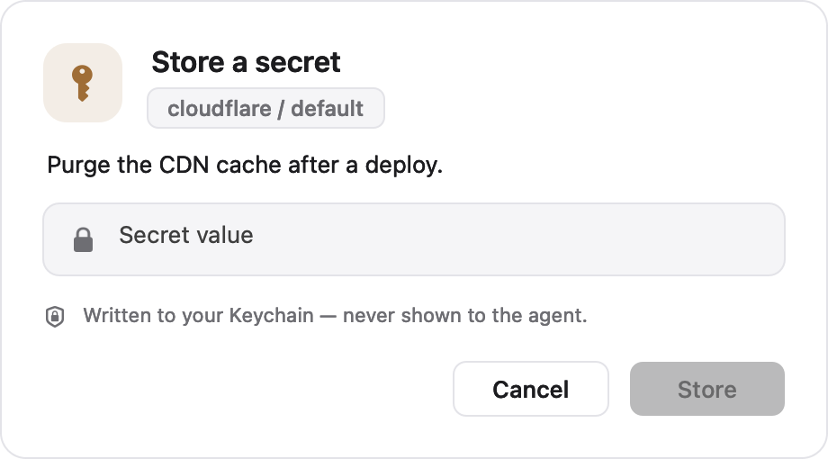
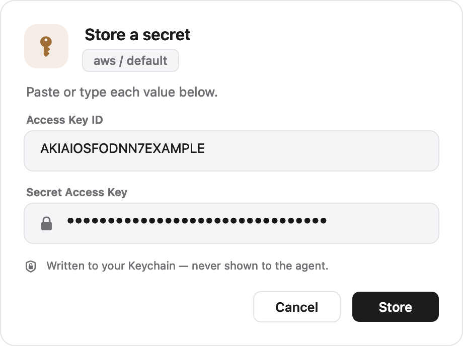

<p align="center">
  
</p>

<h1 align="center">mytokens — User Guide</h1>

<p align="center">
  Keep your API tokens, keys, and connection strings in the macOS <b>iCloud Keychain</b>,
  and let Claude fetch them at the moment it calls an API — without you ever pasting a
  secret into a chat.
</p>

---

## What it is, in one minute

- You store a secret **once**, in a small secure popup. It goes straight into your Keychain.
- Later, when Claude needs that secret to run a command, it reads it from the Keychain
  itself and uses it **inline** — the value never appears in the conversation.
- The value is entered and read only by a **signed macOS Helper**; Claude sees *that a
  secret exists* and its purpose, never the value.

You interact with two things: a one-line command (`mytokens …`, usually run by Claude) and
an occasional **secure popup** when a new secret needs to be stored. This guide walks
through exactly what you'll see.

---

## 1. Install

### Add the skill

```sh
npx skills add sunfmin/mytokens
```

This makes Claude aware of `mytokens`. From now on, before Claude asks you for a credential,
it checks the Keychain first.

### The app installs itself on first use

The `mytokens` command is a small signed app. The first time Claude needs it, it runs the
bundled installer, which downloads the notarized app, puts it in `~/Applications`, links the
`mytokens` command into `~/.local/bin`, and runs a self-check. You can also run it yourself:

```sh
bash ~/.claude/skills/mytokens/scripts/install.sh
```

You'll see it finish with a self-test — this confirms the Keychain works on your Mac:

```
upsert+get=true · list=true · delete=true · gone=true
SELFTEST PASS
```

> macOS only. If the command isn't found afterwards, add `~/.local/bin` to your `PATH`
> (the installer prints the exact line).

---

## 2. Store your first secret — step by step

When a secret isn't stored yet, Claude runs a command like this (you can run it too):

```sh
mytokens put cloudflare --description "Purge the CDN cache after a deploy"
```

**What happens:** a secure window appears. Nothing is stored until you fill it in and click
**Store**.

<p align="center">
  
</p>

Reading the window top to bottom:

| What you see | What it means |
|---|---|
| 🔑 **brass key badge** | This is the mytokens Helper asking to store a secret. |
| **Store a secret** | The action. |
| `cloudflare / default` chip | **Which** secret you're storing — the service and account. Confirm it's the one you expect before pasting. |
| *"Purge the CDN cache after a deploy."* | **Why** the popup appeared — the note Claude wrote so you (and a later session) know what this secret is for. |
| the field with a 🔒 | Where you type or paste the value. It's **masked** — shown as dots. |
| *Written to your Keychain — never shown to the agent* | Where the value goes, and the promise: Claude never receives it. |
| **Cancel / Store** | **Store** stays greyed out until the field has a value. Cancel writes nothing. |

**Step 1 — paste or type the value.** Copy your Cloudflare token and paste it (⌘V) into the
field. It shows as dots.

**Step 2 — click Store.** The window closes and the command prints:

```
stored cloudflare/default
```

That's it. The token is now in your Keychain. It never touched the chat, your shell history,
or Claude.

---

## 3. Store a multi-part credential (e.g. key + secret)

Some credentials come in pieces — an AWS **Access Key ID** *and* **Secret Access Key**, or a
database **username** + **password**. Claude collects them in **one** popup:

```sh
mytokens put aws --description "CI deploy: S3 uploads" \
                 --fields "Access Key ID","Secret Access Key" --show "Access Key ID"
```

<p align="center">
  
</p>

- One labelled row per field.
- **Access Key ID** is shown as plain text (it's an identifier, not a secret) so you can
  eyeball that you pasted the right one. It was marked with `--show`.
- **Secret Access Key** is masked.
- **Store** turns on only when **every** field is filled — you can't save half a credential.

The whole thing is saved as one credential and deletes as a unit. Later you can update just
one part — `mytokens put aws --fields "Secret Access Key"` re-pops only that field and leaves
the Access Key ID — or name both to rotate them together.

---

## 4. Use your secrets

You rarely run these yourself — Claude does — but here's what they do.

**See what's stored** (never shows values):

```sh
$ mytokens list
cloudflare/default	parent	personal
aws/default	static	server  — CI deploy: S3 uploads  fields: Access Key ID, Secret Access Key
```

Each line shows the service/account, its kind, its level (`personal`, or `server` when it
may be pushed to your servers — `put --level server`), the description, and (for multi-part
credentials) the field names — **never the secret itself**.

**Fetch a value** (Claude uses this inline, e.g. inside a `curl`):

```sh
mytokens get cloudflare                       # a single secret → the raw value
mytokens get aws --field "Secret Access Key"  # one field of a multi-part credential
```

For example, Claude runs things like:

```sh
curl -H "Authorization: Bearer $(mytokens get cloudflare)" https://api.cloudflare.com/...
```

so the token is used directly and never stored in a variable or printed.

---

## 5. Point a tool at another provider (Profiles)

A **Profile** is a named bundle of environment variables — an endpoint, a model, and a token —
that you load into a shell in one line. The motivating case: run **Claude Code** against a
different API provider (say GLM) without editing any config files.

Store it once — pass the non-secret config on the command line with `--set`, and only the
secret token pops a masked field (`--fields`):

```sh
mytokens put glm --kind profile --description "Claude Code → GLM" \
  --set "ANTHROPIC_BASE_URL=https://open.bigmodel.cn/api/anthropic" \
  --set "ANTHROPIC_MODEL=glm-4.6" \
  --fields "ANTHROPIC_AUTH_TOKEN"
```

Then load it and launch — `mytokens env` prints shell `export` lines, so `eval` them and run
your tool:

```sh
eval "$(mytokens env glm)" && claude       # …or aider, or anything that reads ANTHROPIC_*
```

Change one variable later without re-entering the rest — `put` merges: `mytokens put glm --set
"ANTHROPIC_MODEL=glm-4.6-pro"`, or `mytokens put glm --fields "ANTHROPIC_AUTH_TOKEN"` to rotate
just the token.

Name a Profile by **provider** (`glm`), not by tool — the same Profile works for any tool that
reads those variables. To keep the token out of your shell for the rest of the session, scope
it to a subshell: `(eval "$(mytokens env glm)"; claude)`.

---

## 6. Rotate or remove

```sh
mytokens put cloudflare                        # re-put to rotate a lone token: same popup, new value
mytokens put glm --set "ANTHROPIC_MODEL=…"     # update just one field of a multi-field secret
mytokens rm  cloudflare                        # delete it entirely
```

`put` updates the fields you name and keeps the rest; to rebuild from scratch (or drop a
field), `rm` then `put`.

### Over SSH

Run `put` in a terminal and it asks there instead of popping the dialog: each secret field
is read with no echo (fields named in `--show` echo), so it works on a Mac you reach only by
SSH:

```sh
ssh -t my-mac mytokens put cloudflare --description "DNS edits" --fields Token
```

### From your phone: the one-time link

With neither a terminal nor a desktop — an agent running `put` on a server — `put` serves
**one page** on the Mac's tailnet address and prints a link to it:

```text
mytokens: open this link to enter the secret for cloudflare / default (it works once, within 10 minutes):
  https://my-server.tailnet-name.ts.net:53765/a7c81fb048650e728fe85acf9a8f0892
```

Open it on any device on your tailnet (your phone), fill in the fields and press **Store**. The
value goes from your browser straight into mytokens and the keychain — never through the
agent, its transcript or a file. The link carries a fresh random token, works **once** for that
one secret, and expires after **10 minutes**; then the page closes and `put` exits (stored, or
not stored with a non-zero exit). Getting the link to your phone is the caller's job; `put`
only prints it.

- It is served on the tailnet address only, never on another interface.
- HTTPS uses the Mac's tailnet certificate (`tailscale cert`). Where this user may not get one,
  the link is plain HTTP on the tailnet (which WireGuard encrypts) and `put` says why. To allow
  HTTPS for a non-admin user, an admin runs `sudo tailscale set --operator=<user>` once, and
  HTTPS certificates must be on for the tailnet.
- The macOS firewall must let MyTokens accept connections: the signed release is allowed
  automatically (*Automatically allow downloaded signed software*); an unsigned local build is
  not, and the link then never answers.
- On a Mac set to `server` (below) `put` never shows the popup — nobody watches a server's
  screen, even a logged-in one — so there it is the terminal, else the link.

With no terminal, no desktop and no tailnet, `put` stores nothing and prints the command to run
in a terminal.

---

## Where do the secrets live?

In **your** iCloud Keychain, under mytokens' own private area, written only by the signed
Helper. That means:

- ✅ They sync to your **other Macs** that have MyTokens installed (same Apple ID).
- ✅ You can see them with `mytokens list` or in **Keychain Access.app**.
- ❌ They do **not** appear in the **Passwords app** — that only lists website logins, not
  third-party API tokens. This is expected, not a bug.
- ❌ `/usr/bin/security` and unsigned scripts can't read them — only the signed Helper can.

---

## Set up a server

A **server** is a Mac of yours that runs unattended — reached over SSH or the tailnet, its
screen locked whenever nobody sits at it — and that you do **not** sign into iCloud. It keeps
its secrets in its own **login keychain** instead of the iCloud Keychain, so jobs on it can
read them while the screen is locked (ADR-0010).

On the server, once:

```sh
bash ~/.claude/skills/mytokens/scripts/install.sh   # the same signed app as on your own Macs
mytokens host server                                # this Mac's role; default: personal
mytokens host                                       # prints it: server
mytokens selftest                                   # round-trips through the login keychain
```

From then on `put`, `get`, `env`, `list` and `rm` act on the server's login keychain:

- Every secret stored there is `server`-level; `put --level personal` is refused.
- Nothing syncs to or from the server — what is on it was entered on it or pushed to it.
- Secrets in your iCloud Keychain stay on your own Macs. `mytokens host personal` switches
  back (the login-keychain secrets stay where they are until you set `server` again).

### Push the server-level secrets

On one of your own Macs, mark the secrets a server needs `server`, then push:

```sh
mytokens put deploy --level server        # an existing secret: only its level changes
mytokens push my-server                   # any host name ssh accepts
```

```
added deploy/default
```

`push` makes the server hold exactly your `server`-level secrets: it adds and updates them,
and removes ones it pushed earlier that are now `personal` or gone. It never touches a secret
entered on the server itself. A second run prints `no changes`. The values travel only in the
SSH pipe, to `mytokens put --stdin` on the server — never on a command line, in the
environment, in a file or in what `push` prints. `put --stdin` is refused on your own Macs.

The role is one small file, `~/Library/Application Support/mytokens/host-role`. Your own
Macs never need it: without it a Mac is `personal` and nothing changes.

---

## Is it safe?

The value is only ever typed into the Helper's secure field and written straight to the
Keychain; it's never sent to Claude. When Claude later *uses* a secret, the raw value does
pass through the command it runs (that's how it reaches the API) — mytokens assumes a
trusted, single-user Mac with FileVault on. See [`docs/adr/`](./docs/adr/) for the full
reasoning.

---

## Advanced

### Build & install from source

Prefer to build and sign it yourself (recommended if you'd rather not run someone else's
signed binary holding your secrets):

- macOS with **Xcode** and a **paid Apple Developer** signing identity (the iCloud
  data-protection keychain needs an entitlement only a signed app can carry — ADR-0001).
- [`xcodegen`](https://github.com/yonaskolb/XcodeGen) (`brew install xcodegen`).

```sh
make install      # xcodegen → signed build → ~/Applications/MyTokens.app + ~/.local/bin/mytokens
make verify       # show the signature + keychain-access-group
mytokens selftest # real-keychain round-trip — should print SELFTEST PASS
```

`project.yml` is the source of truth; the `.xcodeproj` is generated and git-ignored. The team
and bundle id live in `project.yml` (`DEVELOPMENT_TEAM`, `com.sunfmin.mytokens`) and the
access group in `mytokens.entitlements` — change all three together if you fork this. The app
icon is generated from code (`make icon`).

### Releasing (maintainers)

The afkconvoy fleet cuts each version itself once landed work is past the newest tag: it
sets `MARKETING_VERSION` in `project.yml` (the version's one home), tags, runs `make release`
and installs the Release on its host — see the cut blocks in
[`docs/agents/afkconvoy.md`](./docs/agents/afkconvoy.md). By hand it is the same path, built
and published locally — no CI. Notarization creds live in **mytokens itself**
(dogfooding): a secret named `asc-api-key` with fields **Key ID**, **Issuer ID**, and
**Key (base64 .p8)** — an App Store Connect API key. Create the key in App Store Connect →
*Users and Access → Integrations → Team Keys* (role: Developer), then store it:

```sh
base64 -i ~/Downloads/AuthKey_XXXX.p8 | tr -d '\n' | pbcopy   # single-line .p8 → clipboard
mytokens put asc-api-key --description "App Store Connect API key — notarize MyTokens" \
  --fields "Key ID","Issuer ID","Key (base64 .p8)" --show "Key ID","Issuer ID"
```

Then build and publish:

```sh
make dist                # archive → Developer ID export → notarize → staple → zip
make release TAG=v0.1.0  # gh release create + upload build/MyTokens.zip
```

`make dist` reads the API key from mytokens into a temp file (deleted right after), signs
with your Developer ID cert (already in the keychain), and builds with the **Hardened
Runtime** (required for notarization). `scripts/install.sh` downloads `MyTokens.zip` from the
**latest** Release, so bump `TAG` each time. Screenshots are regenerated with
`make screenshots`.

### How it's built

- Domain glossary: [`CONTEXT.md`](./CONTEXT.md)
- Decisions: [`docs/adr/`](./docs/adr/) — iCloud Keychain via a signed helper (0001), `get`
  returns the raw value (0002), a `.app` bundle (0003), minting (0004), multi-field
  Secrets (0005), per-Secret description (0006)
- Skill behavior for Claude: [`skills/mytokens/SKILL.md`](./skills/mytokens/SKILL.md)

## License

[MIT](./LICENSE)
